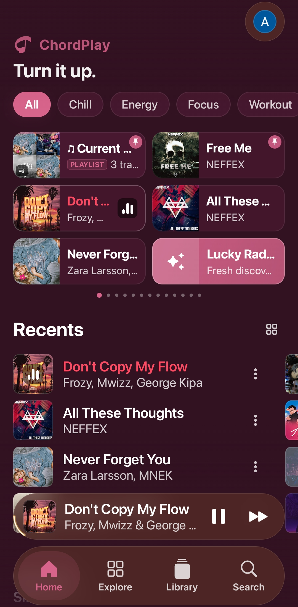
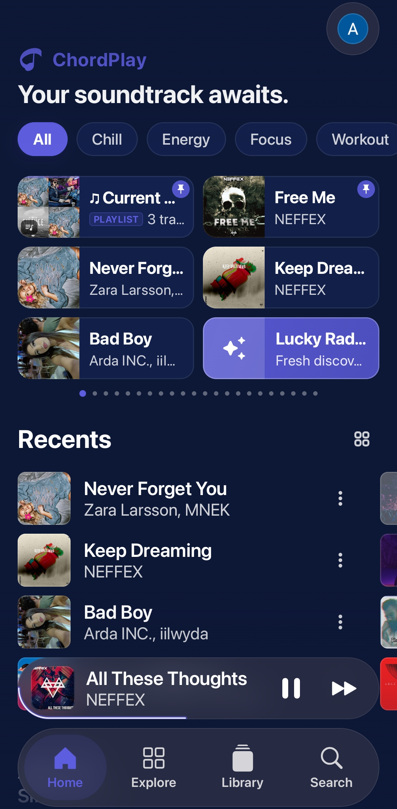
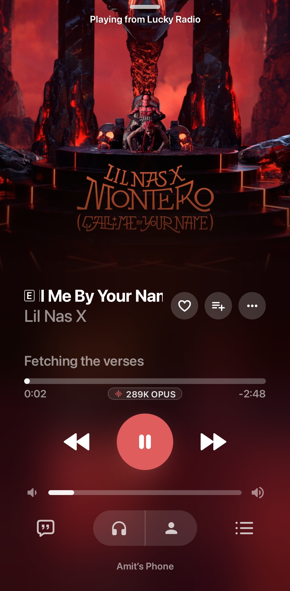
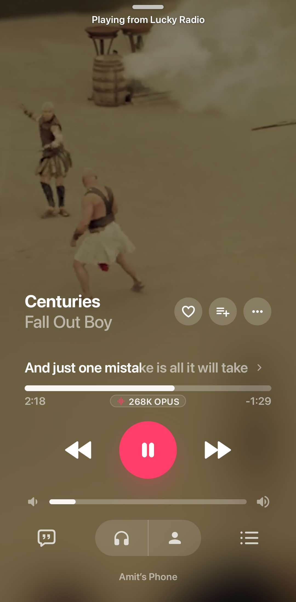

# ChordPlay

**An aesthetic YouTube Music client for Android.**

 

 

[Overview](#overview) • [Screenshots](#screenshots) • [Key Features](#key-features) • [Design System](#design-system--aesthetics) • [Downloads](#downloads) • [Lineage & Attribution](#lineage--attribution) • [License](#license)

---

## Overview

ChordPlay is a modern, high-performance music client designed for listeners who care about both audio quality and visual craft. Engineered with Jetpack Compose and Kotlin Multiplatform, ChordPlay combines the extensive streaming catalog of YouTube Music with a fluid, tactile interface inspired by modern glassmorphic design systems.

> [!NOTE]
> **Official Application ID:** `com.chordplay.music`  
> Starting from version 2.0.0, ChordPlay uses its own independent package ID (`com.chordplay.music`), allowing it to be installed and run seamlessly alongside BitChord without package or signature conflicts. If upgrading from older v1.x sideloaded builds, please perform a clean re-install.

ChordPlay is built upon the open-source foundation of [BitChord](https://github.com/kushagrasinghx/BitChord) by Kushagra Singh, taking its proven streaming and audio architecture and transforming the user experience with custom-crafted UI layers, interactive live settings previews, dynamic theming engines, and refined motion ergonomics.

---

## Screenshots

  <table>
    <tr>
      <td align="center" width="25%"><b>Home (Crimson)</b></td>
      <td align="center" width="25%"><b>Home (Dynamic)</b></td>
      <td align="center" width="25%"><b>Now Playing</b></td>
      <td align="center" width="25%"><b>Canvas & Lyrics</b></td>
    </tr>
    <tr>
      <td valign="top"></td>
      <td valign="top"></td>
      <td valign="top"></td>
      <td valign="top"></td>
    </tr>
  </table>

---

## Key Features

### 1. Living Audio Stages
- **Modern Ambient**: Breathing album-art aura lighting, floating frosted transport deck, and real-time audio bitrate badges (`OPUS` / `AAC`).
- **Vinyl Turntable**: Interactive spinning vinyl with groove texture and an animated tone-arm pickup that moves on play/pause.
- **Classic Clean**: Minimalist, distraction-free playback view.

### 2. Smart Home Speed Dial
- **Visual Identity**: Distinct card styles for Artists (circular frames), Albums (vinyl sleeves), Playlists (stacked cards), and Tracks (squircles).
- **Clean Titles**: Automatically cleans redundant prefixes for a tidy grid.
- **Instant Pinning**: 0s latency reactive toggling to pin or unpin favorites.

### 3. Home & Discovery
- **Contextual Greetings**: Rotating witty greetings personalized with your profile name.
- **Lucky Radio**: One-tap discovery dice generating instant streaming mixes across 25+ genres.
- **Jump Back In**: Quick carousel to resume recent listening sessions right where you left off.

### 4. Dynamic Theming
- **Dynamic Song Art**: Real-time theme adapting colors and ambient aura to the current song's album art.
- **ChordPlay Crimson**: Signature obsidian-and-ruby dark theme.
- **Material You & OLED**: Wallpaper-matched Monet palettes and true `#000000` AMOLED mode.
- **Liquid Glass**: Frosted-glass bottom navigation with fluid spring micro-interactions.

### 5. Tactile Gestures & Controls
- **Swipe-to-Skip**: Swipe left/right on the MiniPlayer to change tracks with spring physics.
- **Playlist Swipe Actions**: Swipe songs to remove them from playlists or pop up the 3-dot context menu.
- **Progress Glow Ring**: Dynamic glowing border tracing playback progress.
- **Micro-Haptics**: Subtle tactile clicks on transport controls and scrubbers.

### 6. Fast Playlist Management
- **Height-Locked Sheet**: Bottom sheet stays fixed when the keyboard opens—no accidental collapses.
- **Two-Way Batch Toggles**: Queue additions or removals in bulk, then commit in one tap.
- **Zero-Lag Performance**: Fast local caching and optimistic UI eliminates stutter.

### 7. Modular Settings & Typography
- **Live Preview Cards**: Real-time interactive previews for Theme and Player settings before applying.
- **Custom Typography**: Handcrafted fonts (Poppins, Parkinsans, Serif) plus custom `.ttf`/`.otf` file import.
- **Synced Lyrics Modes**: Fullscreen single-line lyrics strips, floating capsules, and dedicated lyrics offset tuning.

### 8. Audiophile Streaming & Integrations
- **High-Bitrate Audio**: Streams up to 289K Opus & 256K AAC with gapless playback and crossfade.
- **Synchronized Lyrics**: Syllable-level and line-by-line animations via LRCLIB, Musixmatch, and Genius.
- **Unified Integrations Hub**: YouTube Music account, channel switching, Spotify, Discord Rich Presence, Listen Together, Last.fm, and ListenBrainz in one unnested screen.
- **Offline Downloads**: High-res offline caching with embedded artwork and full ID3 tags.

---

## Design System & Aesthetics

ChordPlay is built on the **ChordPlay Design System**, adhering to strict aesthetic tokens:

| Token / Layer | Implementation | Purpose |
| :--- | :--- | :--- |
| **Canvas (L0)** | Fullscreen blurred artwork aura + mesh gradient | Living ambient atmosphere that shifts with track art |
| **Base Scrim (L1)** | Deep background (`#0D0E12` or OLED `#000000`) | High-contrast foundation ensuring WCAG AA legibility |
| **Frosted Cards (L2)** | Translucent panels with Haze blur and 1dp border stroke | Structural separation without visual heaviness |
| **Floating Deck (L3)** | Floating pill capsule with haptic transport controls | Ergonomic one-handed thumb reachability |
| **Modal Sheets (L4)** | Full-height sheets with keyboard-resilient layout | Smooth drag dismiss and stable in-sheet search |

---

## Downloads

Download the latest pre-compiled APK from the [Releases](https://github.com/code4nigel/ChordPlay/releases) page:

| Package | Architecture | Description |
| :--- | :--- | :--- |
| **Universal APK** (Recommended) | All ABIs (`arm64-v8a`, `armeabi-v7a`, `x86_64`) | Compatible with all modern and legacy Android devices |
| **ARM64-v8a APK** | `arm64-v8a` | Optimized, lightweight package for modern 64-bit Android smartphones |

### Automatic In-App Updates
ChordPlay contains a built-in update detector. When a new release is published on GitHub, the app alerts you with the update changelog and provides one-tap in-app download and installation.

---

## Lineage & Attribution

ChordPlay is an open-source project built with deep gratitude toward the developers who make independent Android music software possible.

| Project | Author | Role in ChordPlay |
| :--- | :--- | :--- |
| [BitChord](https://github.com/kushagrasinghx/BitChord) | Kushagra Singh ([@kushagrasinghx](https://github.com/kushagrasinghx)) | Foundational audio service, YouTube Music stream extraction, download pipeline, and baseline architecture |
| [Prism](https://github.com/Yigder/Prism) | Yigder ([@Yigder](https://github.com/Yigder)) | Inspiration for modular settings and interactive live preview cards |
| [Metrolist](https://github.com/metrolistgroup/metrolist) | Metrolist Group | Inspiration for local playlist caching and indexing |
| [Haze](https://github.com/chrisbanes/haze) | Chris Banes | High-performance blur and frosted glass rendering for Compose |
| [am-lyrics](https://github.com/binimum/am-lyrics) | binimum | Synchronized lyrics animation concepts |
| [NewPipeExtractor](https://github.com/TeamNewPipe/NewPipeExtractor) | Team NewPipe | YouTube stream extraction engine |

---

## License

ChordPlay is licensed under the **GNU General Public License v3.0 (GPLv3)**.

- **BitChord**: Copyright (C) 2024-2026 Kushagra Singh and BitChord contributors.
- **ChordPlay modifications & additions**: Copyright (C) 2026 Shivanshu (code4nigel).

See the [LICENSE](LICENSE) file for the full text of the GNU General Public License v3.0.
