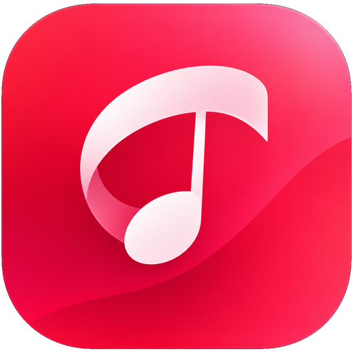

# ChordPlay

An aesthetic, customizable YouTube Music client for Android. Built as an open-source project exploring modern Android audio engineering and UI design, based on **BitChord**.

 

 

[About](#about--lineage) • [Features](#features) • [Downloads](#downloads) • [Credits](#lineage--credits) • [License](#license)

---

## About & Lineage

ChordPlay is an open-source Android music player developed to explore modern Jetpack Compose architecture, Media3 audio services, and design ergonomics.

The project is built directly on top of [BitChord](https://github.com/kushagrasinghx/BitChord) by **Kushagra Singh** ([@kushagrasinghx](https://github.com/kushagrasinghx)). BitChord provides approximately 90% of the foundational architecture—including YouTube Music stream extraction, audio playback services, caching, and download pipelines—licensed under the GNU General Public License v3.0 (GPLv3).

ChordPlay extends this foundation with focused customizations: modular settings with live preview cards (inspired by Prism), custom font loading, zero-lag playlist batch toggling, and visual polish.

---

## Features

### ChordPlay Additions & Customizations
- **Modular Settings with Live Previews**: Reorganized settings into clean categories with real-time preview cards for appearance, lyrics typography, and player styling.
- **Custom Lyrics Typography**: Built-in fonts (Poppins, Parkinsans, Serif, Sans, Monospace, Cursive) plus support for importing custom `.ttf` and `.otf` font files from device storage.
- **Two-Way Playlist Toggle**: Tap to queue additions or removals with an explicit "Done" button to batch changes safely without premature network calls.
- **Instant Playlist Search & Caching**: Fast local caching and search inside the playlist picker with zero UI lag.
- **Playlist Source Badges**: Clear badges distinguishing local ChordPlay playlists from synced YouTube Music playlists.
- **Last.fm Scrobbling**: Integrated Last.fm scrobbler support.
- **Smoothed Motion**: Refined motion easing curves for grounded transitions.

### Core Features (from BitChord)
- **YouTube Music Streaming**: Ad-free audio streaming and catalog search powered by NewPipeExtractor.
- **Gapless Playback & Crossfade**: Smooth transitions between songs, configurable crossfade, and experimental automix.
- **Synchronized Lyrics**: Word-level and line-by-line animated lyrics with romanization support across multiple providers (LRCLIB, Musixmatch, Genius, KuGou).
- **Offline Downloads**: Save tracks locally with embedded high-resolution artwork and metadata tags.
- **Local Audio Playback**: Unified playback for on-device audio files.
- **Translucent UI**: Dynamic blur effects powered by Haze with Material 3 dynamic color theming.
- **Integrations**: Google YouTube Music library sync, Spotify playlist import, and Discord Rich Presence.

---

## Downloads

Download the latest pre-compiled APK from the [Releases](https://github.com/code4nigel/ChordPlay/releases) page:

- **Universal APK** (Recommended): Works across all supported Android architectures (`arm64-v8a`, `armeabi-v7a`, `x86_64`).
- **ARM64-v8a APK**: Smaller file size, optimized for modern 64-bit devices.

ChordPlay includes an in-app update checker that notifies you when newer releases are published.

---

## Lineage & Credits

ChordPlay is made possible by open-source creators:

| Project | Author | Role |
| :--- | :--- | :--- |
| [BitChord](https://github.com/kushagrasinghx/BitChord) | Kushagra Singh ([@kushagrasinghx](https://github.com/kushagrasinghx)) | Foundational architecture (~90% of playback, streaming, and UI foundation) |
| [Prism](https://github.com/Yigder/Prism) | Yigder ([@Yigder](https://github.com/Yigder)) | Inspiration for modular settings and live preview cards |
| [Metrolist](https://github.com/metrolistgroup/metrolist) | Metrolist Group | Inspiration for local playlist caching and indexing |
| [Haze](https://github.com/chrisbanes/haze) | Chris Banes | Blur rendering for Jetpack Compose |
| [am-lyrics](https://github.com/binimum/am-lyrics) | binimum | Synchronized lyrics animation concepts |
| [NewPipeExtractor](https://github.com/TeamNewPipe/NewPipeExtractor) | Team NewPipe | YouTube stream extraction |

---

## License

ChordPlay is distributed under the **GNU General Public License v3.0 (GPLv3)**.

- **BitChord**: Copyright (C) 2024-2026 Kushagra Singh and BitChord contributors.
- **ChordPlay modifications & additions**: Copyright (C) 2026 Shivanshu (code4nigel).

See the [LICENSE](LICENSE) file for the full text of the GNU General Public License v3.0.

