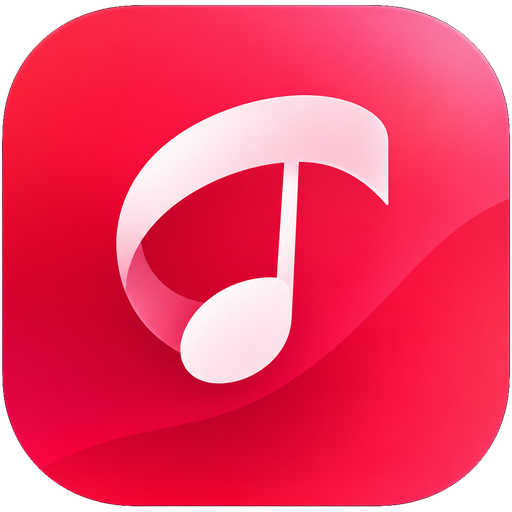
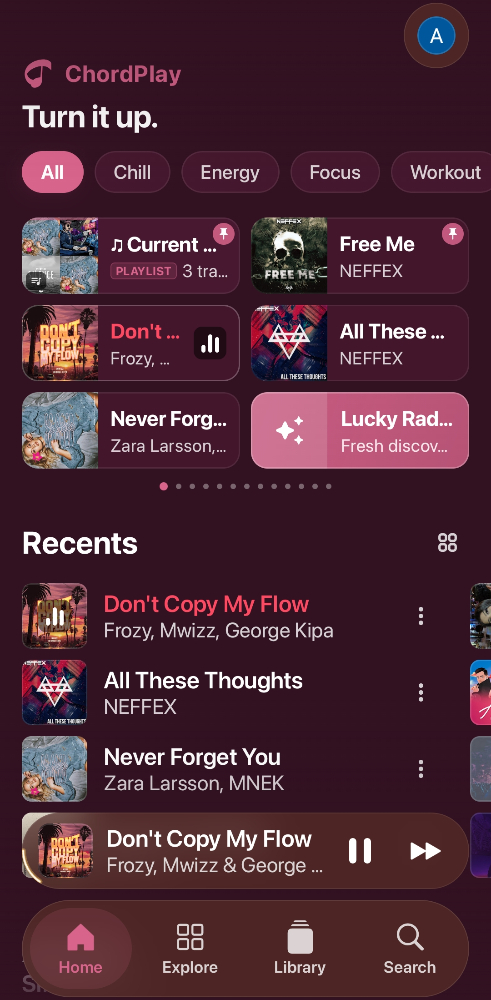
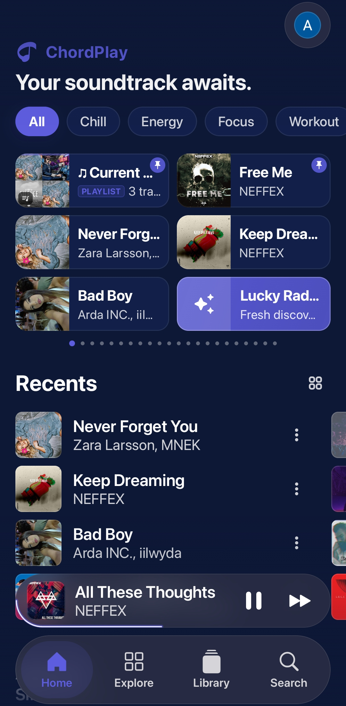
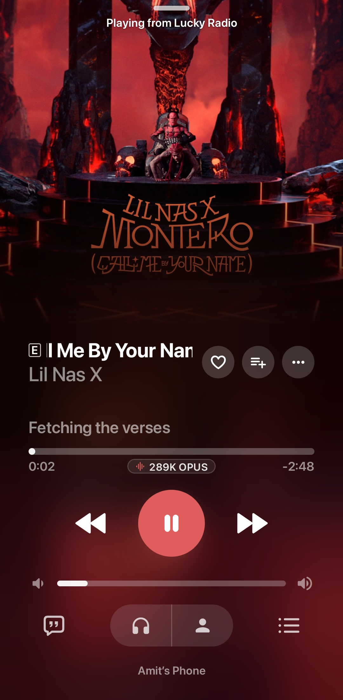
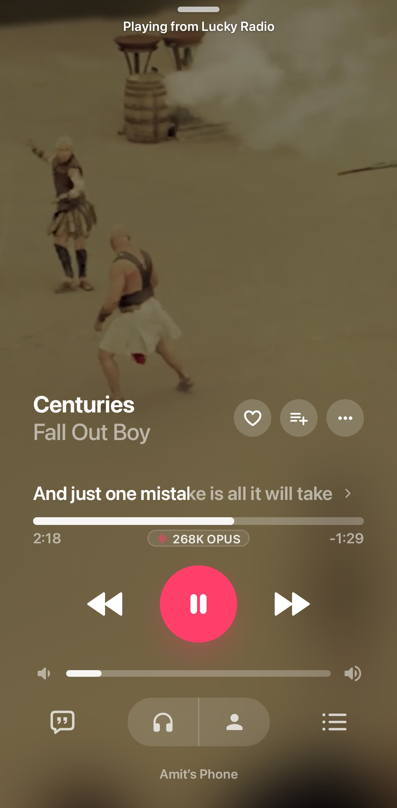

# ChordPlay

**An aesthetic YouTube Music client for Android.**

 

 

[Overview](#overview) • [Screenshots](#screenshots) • [Key Features](#key-features) • [Design System](#design-system--aesthetics) • [Downloads](#downloads) • [Lineage & Attribution](#lineage--attribution) • [License](#license)

---

## Overview

> [!IMPORTANT]
> **Lyrics Providers Notice**: If any lyrics provider has an issue with offline lyrics downloads, please message or email at [impemailsyuses@gmail.com](mailto:impemailsyuses@gmail.com). 
> ChordPlay is not affiliated with, endorsed by, or connected to YouTube or Google in any way. Use it at your own discretion.

ChordPlay is a modern, high-performance music client designed for listeners who care about both audio quality and visual craft. Engineered with Jetpack Compose and Kotlin Multiplatform, ChordPlay combines the extensive streaming catalog of YouTube Music with a fluid, tactile interface inspired by modern glassmorphic design systems.

> [!NOTE]
> **Official Application ID:** `com.chordplay.music`  
> Starting from version 2.0.0, ChordPlay uses its own independent package ID (`com.chordplay.music`), allowing it to be installed and run seamlessly alongside BitChord without package or signature conflicts. If upgrading from older v1.x sideloaded builds, please perform a clean re-install.

ChordPlay is built upon the open-source foundation of [BitChord](https://github.com/kushagrasinghx/BitChord) by Kushagra Singh, taking its proven streaming and audio architecture and transforming the user experience with custom-crafted UI layers, interactive live settings previews, dynamic theming engines, and refined motion ergonomics.

---

## Screenshots

  <table>
    <tr>
      <td align="center" width="25%"><b>Home (Crimson)</b></td>
      <td align="center" width="25%"><b>Home (Dynamic)</b></td>
      <td align="center" width="25%"><b>Now Playing</b></td>
      <td align="center" width="25%"><b>Canvas & Lyrics</b></td>
    </tr>
    <tr>
      <td valign="top"></td>
      <td valign="top"></td>
      <td valign="top"></td>
      <td valign="top"></td>
    </tr>
  </table>

---

## Key Features

### 1. Living Audio Stages
- **Modern Ambient**: Breathing album-art aura lighting, floating frosted transport deck, and real-time audio bitrate badges (`OPUS` / `AAC`).
- **Vinyl Turntable**: Interactive spinning vinyl with groove texture and an animated tone-arm pickup that moves on play/pause.
- **Classic Clean**: Minimalist, distraction-free playback view.

### 2. "Your Space" & Discovery
- **"Your Space" Grid**: Distinct card styles for Artists (circular frames), Albums (vinyl sleeves), Playlists (stacked cards), and Tracks (squircles) with instant pinning and 1×4 track column list mode.
- **Mixes & Radio**: Direct integration with custom mixes, quick picks, and contextual radios.
- **Lucky Radio**: One-tap discovery dice with adaptive theming generating instant streaming mixes across 25+ genres.
- **Home Shelves Reordering**: Full customization to toggle and reorder all home recommendation shelves—move community playlists, mixes, or genres right to the top.

### 3. Dynamic Theming & Living Stages
- **Modern Ambient**: Breathing album-art aura lighting, seamless continuous waveform ring around the play button, and real-time audio bitrate badges (`OPUS` / `AAC`).
- **Dynamic Artwork Palette**: Real-time theme extracting adaptive colors directly from whatever song is currently playing, with high-contrast text and adaptive top bar navigation.
- **Morphing Transport Controls**: Player controls dynamically morph and expand when opening the queue, while repeat/shuffle gently fade.
- **Preserve Style**: Freeze and save active dynamic artwork colorways as reusable custom presets directly from the Profile Selector.
- **Liquid Glass**: Frosted-glass navigation with fluid spring micro-interactions and intensity slider.

### 4. Fast Playlist Management & In-Playlist Search
- **In-Playlist Direct Add**: Tap the `+` button directly within any playlist to search YouTube Music or suggested recommendations and add songs without leaving the page.
- **Two-Way Reactive Toggling**: Easily check or uncheck songs to add or remove them instantly with haptic feedback.
- **Height-Locked Sheet**: Bottom sheet stays fixed when the keyboard opens—no accidental collapses.
- **Zero-Lag Performance**: Fast local caching, robust membership tracking, and optimistic UI eliminates stutter.

### 5. Modular Settings & Checkout Hub
- **Top Settings Search**: Clean pill search bar to instantly find any preference or option.
- **Featured Checkout**: Fast access to Account & Integrations, Listen Together (Play Together), Spotify Login, and Liquid Glass intensity.
- **Live Preview Cards**: Real-time interactive previews for Theme and Player settings before applying.
- **Custom Typography**: Handcrafted fonts (Poppins, Parkinsans, Serif) plus custom `.ttf`/`.otf` file import.

### 6. Audiophile Streaming, Offline Lyrics & Integrations
- **Offline Synced Lyrics**: Save synchronized (word-by-word and line-by-line) lyrics offline alongside downloaded songs, with personal offline usage agreement.
- **High-Bitrate Audio**: Streams up to 289K Opus & 256K AAC with gapless playback and crossfade.
- **Synchronized Lyrics**: Syllable-level and line-by-line animations via LRCLIB, Musixmatch, and Genius.
- **Unified Integrations Hub**: YouTube Music account, channel switching, Spotify, Discord Rich Presence, Listen Together, Last.fm, and ListenBrainz in one unnested screen.
- **Offline Downloads & Library**: Robust offline playback for downloaded songs, albums, playlists, and local files even without an internet connection.

---

## Design System & Aesthetics

ChordPlay is built on the **ChordPlay Design System**, adhering to strict aesthetic tokens:

| Token / Layer | Implementation | Purpose |
| :--- | :--- | :--- |
| **Canvas (L0)** | Fullscreen blurred artwork aura + mesh gradient | Living ambient atmosphere that shifts with track art |
| **Base Scrim (L1)** | Deep background (`#0D0E12` or OLED `#000000`) | High-contrast foundation ensuring WCAG AA legibility |
| **Frosted Cards (L2)** | Translucent panels with Haze blur and 1dp border stroke | Structural separation without visual heaviness |
| **Floating Deck (L3)** | Floating pill capsule with haptic transport controls | Ergonomic one-handed thumb reachability |
| **Modal Sheets (L4)** | Full-height sheets with keyboard-resilient layout | Smooth drag dismiss and stable in-sheet search |

---

## Downloads

Download the latest pre-compiled APK from the [Releases](https://github.com/code4nigel/ChordPlay/releases) page:

| Package | Architecture | Description |
| :--- | :--- | :--- |
| **Universal APK** (Recommended) | All ABIs (`arm64-v8a`, `armeabi-v7a`, `x86_64`) | Compatible with all modern and legacy Android devices |
| **ARM64-v8a APK** | `arm64-v8a` | Optimized, lightweight package for modern 64-bit Android smartphones |

### Automatic In-App Updates
ChordPlay contains a built-in update detector. When a new release is published on GitHub, the app alerts you with the update changelog and provides one-tap in-app download and installation.

---

## Lineage & Attribution

ChordPlay is an open-source project built with deep gratitude toward the developers who make independent Android music software possible.

| Project | Author | Role in ChordPlay |
| :--- | :--- | :--- |
| [BitChord](https://github.com/kushagrasinghx/BitChord) | Kushagra Singh ([@kushagrasinghx](https://github.com/kushagrasinghx)) | Foundational audio service, YouTube Music stream extraction, download pipeline, and baseline architecture |
| [Prism](https://github.com/Yigder/Prism) | Yigder ([@Yigder](https://github.com/Yigder)) | Inspiration for modular settings and interactive live preview cards |
| [Metrolist](https://github.com/metrolistgroup/metrolist) | Metrolist Group | Inspiration for local playlist caching and indexing |
| [Haze](https://github.com/chrisbanes/haze) | Chris Banes | High-performance blur and frosted glass rendering for Compose |
| [am-lyrics](https://github.com/binimum/am-lyrics) | binimum | Synchronized lyrics animation concepts |
| [NewPipeExtractor](https://github.com/TeamNewPipe/NewPipeExtractor) | Team NewPipe | YouTube stream extraction engine |

---

## License

ChordPlay is licensed under the **GNU General Public License v3.0 (GPLv3)**.

- **BitChord**: Copyright (C) 2024-2026 Kushagra Singh and BitChord contributors.
- **ChordPlay modifications & additions**: Copyright (C) 2026 Shivanshu (code4nigel).

See the [LICENSE](LICENSE) file for the full text of the GNU General Public License v3.0.
